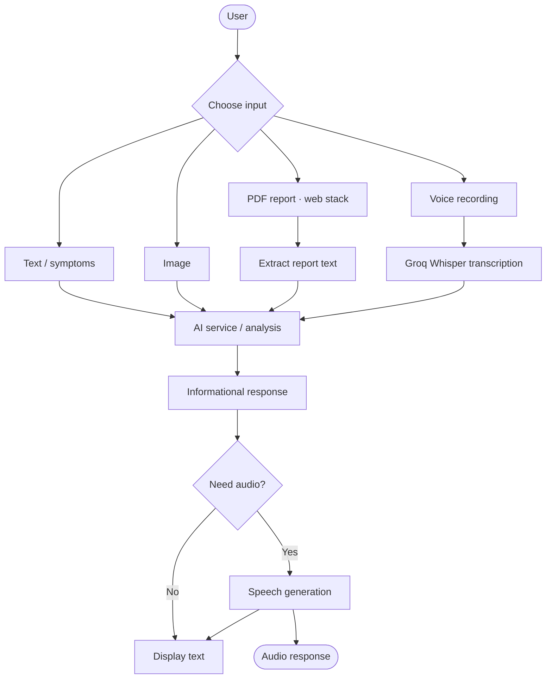
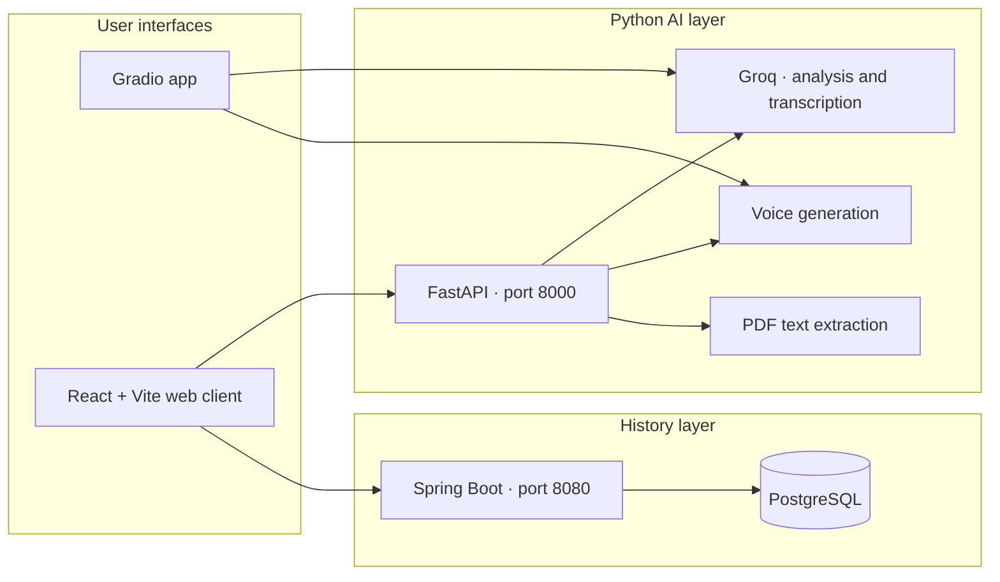

<div align="center">

# 🩺 AI Doctor — Vision & Voice

### A multimodal healthcare-assistance project for text, voice, images, and medical reports.

[](https://www.python.org/)
[](https://fastapi.tiangolo.com/)
[](https://react.dev/)
[](https://spring.io/projects/spring-boot)
[](https://www.postgresql.org/)
[](https://groq.com/)

*Describe symptoms, share a supported image or report, or speak naturally—then receive an informational AI-generated response with optional audio output.*

**Educational project only · Not a medical device · Not a substitute for professional care**

</div>

---

## ✨ At a glance

| 🧠 Multimodal analysis | 🎙️ Voice input & output | 🗂️ Consultation history |
|:---:|:---:|:---:|
| Text, supported images, and PDF report text | Groq Whisper transcription, with ElevenLabs or gTTS speech output in the Gradio app | React interface backed by a Spring Boot service and PostgreSQL |

## 🧭 Quick navigation

- [Features](#-features)
- [How it works](#-how-it-works)
- [Architecture](#-architecture)
- [Project structure](#-project-structure)
- [Prerequisites](#-prerequisites)
- [Configuration](#-configuration)
- [Run locally](#-run-locally)
- [API reference](#-api-reference)
- [Troubleshooting](#-troubleshooting)
- [Safety and disclaimer](#-safety-and-disclaimer)
- [Contributing](#-contributing)
- [Authors](#-authors)

---

## 🚀 Features

- 🖼️ **Image analysis** using a vision-capable Groq model.
- 🎤 **Voice transcription** using Groq Whisper.
- 💬 **Text-based responses** for symptoms and questions.
- 🔊 **Generated audio responses** through ElevenLabs, with gTTS fallback in the Gradio application.
- 📄 **PDF report text extraction** in the web AI service.
- 🧑‍⚕️ **Patient and consultation history** in the React web interface.
- ☕ **Spring Boot history service** backed by PostgreSQL.
- ⚡ **FastAPI AI service** for analysis and speech-generation endpoints.
- 🧪 **Two ways to run the project:** a standalone Gradio application or the multi-service web stack.

> **Scope note:** The Gradio app and web stack have different capabilities. PDF extraction and the React-based history experience belong to the web stack; do not assume every feature is available in the Gradio app.

## 🧩 How it works



## 🏗️ Architecture

The repository contains a legacy Gradio experience and a separate web application made up of a React client, a FastAPI AI service, and a Spring Boot history service.



### Technology stack

| Layer | Technologies |
|---|---|
| Legacy interface | Gradio, Python |
| Web frontend | React, Vite |
| AI API | FastAPI, Groq |
| Speech input | Groq Whisper |
| Speech output | ElevenLabs; gTTS fallback in Gradio |
| History API | Java 17, Spring Boot, Maven |
| Database | PostgreSQL |
| Local database runtime | Docker Compose |

## 📁 Project structure

```text
AI-DOCTOR/
├── gradioapp.py                 # Legacy Gradio application
├── brainofdoctor.py             # Standalone image-analysis example
├── voiceofdoctor.py             # ElevenLabs and gTTS helpers
├── voiceofpatient.py            # Standalone microphone/transcription example
├── requirements.txt             # Gradio application dependencies
├── ai-service/
│   ├── main.py                  # FastAPI analysis and voice API
│   └── requirements.txt         # AI service dependencies
├── history-service/
│   ├── pom.xml                  # Spring Boot / Maven configuration
│   └── src/                     # History service source code
├── frontend/                    # React + Vite web client
├── docker-compose.yml           # PostgreSQL development database
└── README_WEB_STACK.md          # Additional web-stack notes
```

Generated files such as Python caches, `node_modules`, frontend builds, Maven `target` output, and local environment files should stay out of version control.

## ✅ Prerequisites

Install the tools for the app you intend to run.

| Tool | Gradio app | Web stack |
|---|:---:|:---:|
| Python 3.11+ | ✅ | ✅ |
| Groq API key | ✅ | ✅ |
| ElevenLabs API key + voice ID | Optional | Optional, depending on implementation |
| FFmpeg / PortAudio | May be required by audio dependencies | May be required by audio dependencies |
| Node.js + npm | — | ✅ |
| Java 17 + Maven | — | ✅ |
| Docker Desktop | — | ✅ (for included PostgreSQL container) |

## 🔐 Configuration

### 1. Add your API keys

Create a `.env` file in the repository root. Keep it private and **never commit it**.

```env
GROQ_API_KEY=your_groq_api_key
GROQ_MODEL=qwen/qwen3.8-27b

# Optional: used when ElevenLabs speech output is enabled
ELEVENLABS_API_KEY=your_elevenlabs_api_key
ELEVENLABS_VOICE_ID=your_elevenlabs_voice_id
```

Use the model identifier supported by the Groq account and API configuration you are running. Do not paste real API keys into source code, screenshots, issues, or commits.

### 2. Configure the frontend URLs

The frontend development defaults are:

```env
VITE_HISTORY_API_URL=http://localhost:8080/api
VITE_AI_API_URL=http://localhost:8000
```

To override them, create `frontend/.env.local` and add the variables above. Vite-exposed variables are included in the browser bundle, so **never put secrets or private API keys in `VITE_*` variables**. The repository's `frontend/.env.example` documents the variable names.

## 💻 Run locally

Choose **one** of the following paths, or start all services for the web stack.

<details>
<summary><strong>Option A — Run the Gradio application</strong></summary>

From the repository root, open PowerShell:

```powershell
python -m venv .venv
.\.venv\Scripts\Activate.ps1
pip install -r requirements.txt
```

Add your Groq key to the root `.env`, then launch:

```powershell
python gradioapp.py
```

Open the local URL printed in the terminal, normally [`http://127.0.0.1:7860`](http://127.0.0.1:7860).

The Gradio interface accepts a voice recording and an image of a skin condition, then returns text/transcription output and generated audio, depending on the configured services.

</details>

<details>
<summary><strong>Option B — Run the complete web stack</strong></summary>

### Step 1 — Start PostgreSQL

Make sure Docker Desktop is installed and running, then execute this from the repository root:

```powershell
docker compose up -d postgres
```

### Step 2 — Start the FastAPI AI service

Open a terminal at the repository root. Activate your virtual environment and install the AI service dependencies:

```powershell
.\.venv\Scripts\Activate.ps1
pip install -r ai-service\requirements.txt
uvicorn main:app --app-dir ai-service --reload --port 8000
```

- API base: [`http://localhost:8000`](http://localhost:8000)
- Health check: [`http://localhost:8000/health`](http://localhost:8000/health)
- Interactive API docs, if enabled by FastAPI: [`http://localhost:8000/docs`](http://localhost:8000/docs)

Keep this terminal running.

### Step 3 — Start the Spring Boot history service

In a **second terminal**:

```powershell
cd history-service
mvn spring-boot:run
```

The history service runs at [`http://localhost:8080`](http://localhost:8080), assuming the application configuration uses the default port.

### Step 4 — Start the React frontend

In a **third terminal**:

```powershell
cd frontend
npm install
npm run dev
```

Open the URL printed by Vite, normally [`http://localhost:5173`](http://localhost:5173).

To build the frontend for production:

```powershell
npm run build
```

</details>

## 🔌 API reference

### AI service — FastAPI (`localhost:8000`)

| Method | Endpoint | Purpose |
|---|---|---|
| `GET` | `/health` | Check whether the AI service is responding |
| `POST` | `/api/analyze` | Analyze submitted symptoms, supported images, PDF reports, and/or audio |
| `POST` | `/api/speak` | Generate MP3 speech from analysis text |

### History service — Spring Boot (`localhost:8080`)

The history service exposes patient and consultation endpoints under:

- `/api/patients`
- `/api/consultations`

Request schemas and response formats depend on the implementation in the service source code.

## 🛠️ Troubleshooting

<details>
<summary><strong>PowerShell says script execution is disabled</strong></summary>

If activation of `.venv` is blocked by your PowerShell execution policy, use a permitted activation method for your machine or run the environment's Python executable directly. Avoid changing system-wide security settings unless you understand the implications.

</details>

<details>
<summary><strong>The AI service cannot find the API key</strong></summary>

Confirm that the root `.env` exists and contains `GROQ_API_KEY`. Environment files are not automatically loaded by every Python process; verify how the application loads configuration and follow its expected startup directory. Restart the service after changing environment variables.

</details>

<details>
<summary><strong>The frontend cannot reach an API</strong></summary>

Check that the AI and history services are running, confirm the URLs in `frontend/.env.local`, and review the browser console and backend terminal for CORS or connection errors. Restart Vite after changing its environment file.

</details>

<details>
<summary><strong>PostgreSQL or Docker fails to start</strong></summary>

Check that Docker Desktop is running, then inspect the container state and logs:

```powershell
docker compose ps
docker compose logs postgres
```

Check the database settings expected by the Spring Boot application against the values configured in `docker-compose.yml`.

</details>

<details>
<summary><strong>Microphone, audio, or transcription errors</strong></summary>

Check operating-system microphone permissions and confirm that the audio dependencies required by your environment are installed. FFmpeg and PortAudio may be needed for some audio workflows. Review the terminal output for the specific missing package or device error.

</details>

## 🛡️ Safety and disclaimer

AI Doctor is an **educational healthcare-assistance project**. It may make mistakes, omit important context, or produce misleading output. It is not validated for clinical use and must not be used to diagnose conditions, choose treatment, or delay care.

- Do not rely on this project for medical emergencies or time-critical decisions.
- Seek a qualified healthcare professional for medical advice, diagnosis, and treatment.
- If symptoms may indicate an emergency, contact local emergency services immediately.
- Avoid uploading identifiable patient information unless you have appropriate permission and have evaluated the privacy and security implications.

## 🤝 Contributing

Contributions, bug reports, and thoughtful suggestions are welcome.

1. Fork the repository.
2. Create a focused feature branch.
3. Make your changes and test them locally.
4. Open a pull request with a clear description of the change and any relevant testing notes.

Please do not include secrets, real patient data, generated audio, dependency folders, or build output in commits.

## 👥 Authors

**Kush Sahu** · **Arshika Thakkar**

---

<div align="center">

**Built for learning and experimentation. Designed to assist—not replace—professional medical care.**

</div>
